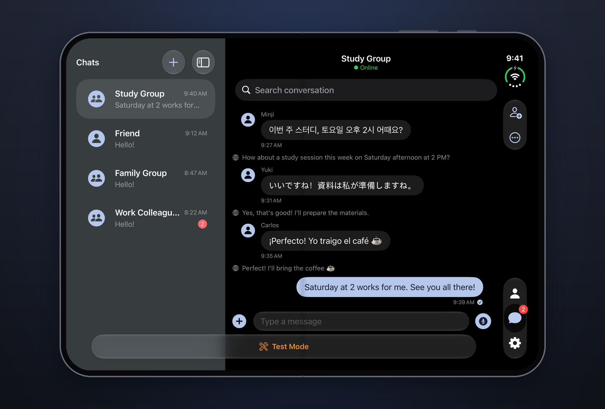

# L!NK

**언어의 경계 없는 메신저.**

[English](README.md) · 한국어

나는 한국어로, 상대는 일본어로 써도 둘 다 자기 언어로 읽습니다. L!NK는 메시지마다 아래에 번역을 붙이고 나머지는 덜어 낸 미니멀 메신저입니다.

모든 AI 기능은 기기 안의 Apple Intelligence로 돌아가고 서버가 없습니다. 대화 상대는 시뮬레이션이라, 계정 없이 테스트 모드로 바로 써 볼 수 있습니다.

## 주요 기능

- **인라인 번역**: 모든 메시지를 기기 안에서 번역, 7개 언어.
- **기기 안 AI**: 대화 요약, 담당자·날짜가 붙은 회의 노트, 추천 답장, 언어를 넘나드는 의미 검색, iOS 27의 사진 설명.
- **메시지**: 받아쓰기가 붙는 음성 메시지, 사진·파일·위치, 리액션, 자폭·예약 메시지.
- **모든 화면**: 아이폰, iPad, 접거나 펼친 iPhone Duo.
- **모두를 위해**: 다이나믹 타입, VoiceOver, 앱 언어 5개, Siri·단축어, 앱 잠금.

## 스크린샷

iOS 27 시뮬레이터의 샘플 대화입니다. 그 안의 번역, 답장, 요약, 노트는 기기 안 모델이 실제로 만든 결과입니다.

**추천 답장과 의미로 검색.** 상대가 메시지를 보내면 짧은 답장 3개가 나타납니다. "저녁 약속"으로 검색하면 "dinner tonight"을 찾습니다.

**요약과 회의 노트.** 할 일마다 근거 메시지를 인용하고, 날짜는 모델이 아니라 날짜 감지기가 찾습니다.

**iPhone Duo.** 펼치면 채팅 목록이 대화 옆에 그대로 남고, 접으면 한 화면씩 보입니다.

## 만든 방법

SwiftUI와 SwiftData, 프로토콜 기반 리포지토리를 쓰는 MVVM, Foundation Models, Translation·Speech 프레임워크, App Intents. iOS 26 이상에서 돌고, iOS 27 기능은 있는 기기에서만 켭니다. 로직은 Swift Testing으로, 화면 흐름은 아이폰과 iPad에서 XCTest UI 테스트로 확인합니다.

작은 온디바이스 모델이 없는 할 일을 지어내지 않게 만든 과정처럼 가장 손이 많이 간 부분과 프로젝트 구조, 아이폰에서 실행하는 법, 테스트 명령은 [docs/ENGINEERING.ko.md](docs/ENGINEERING.ko.md)에 있습니다.

## 실행하기

1. Xcode 27 이상에서 `TalkMVP.xcodeproj`를 엽니다.
2. iOS 26 이상 시뮬레이터에서 실행합니다.
3. **테스트 모드로 체험하기**를 누르면 샘플 친구·채팅과 함께 시작합니다.

## 라이선스

Copyright © 2025–2026 David Song. All rights reserved.

이 저장소는 포트폴리오 목적으로 GitHub에 공개되어 있습니다. 소스를 열람할 수 있다는 것이 사용 권한을 의미하지는 않습니다 — 사전 서면 허가 없이 이 코드의 전체 또는 일부를 복사, 수정, 배포, 재사용하는 것은 허용되지 않으며, AI 모델 학습 데이터로 쓰는 것도 마찬가지입니다. GitHub에서의 열람과 포크는 GitHub 이용약관이 정한 범위에서만 허용되며, 포크했다고 해서 다른 권리가 생기지는 않습니다. 사용 허가는 [@mobssy](https://github.com/mobssy)로 문의해 주세요. 자세한 내용은 [LICENSE](LICENSE)를 참고하세요.
