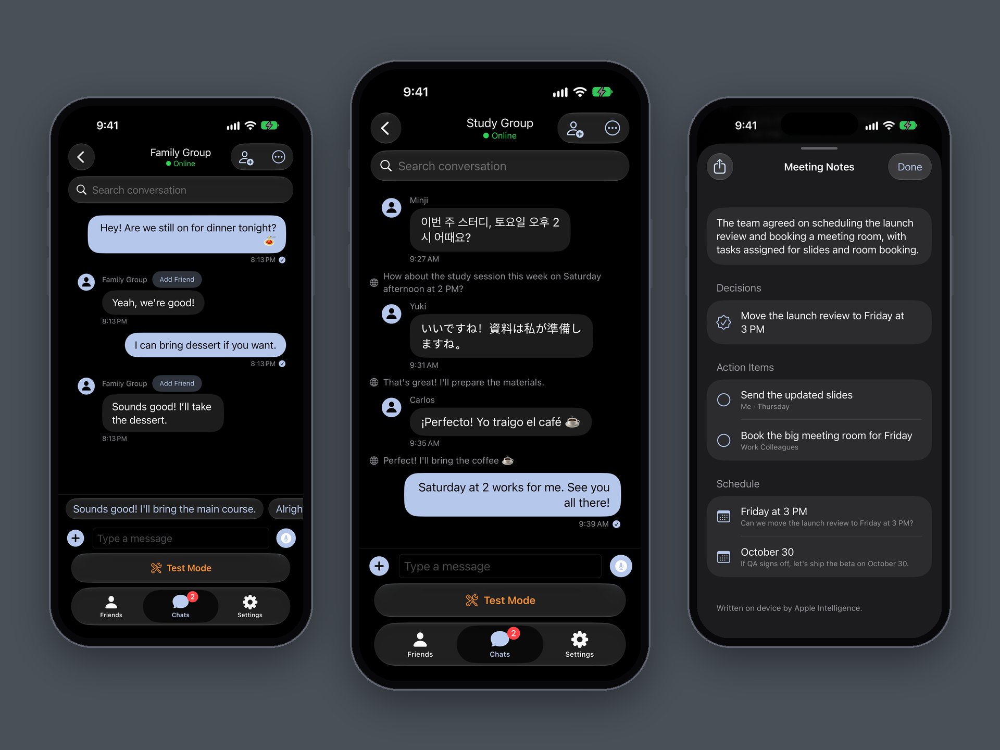
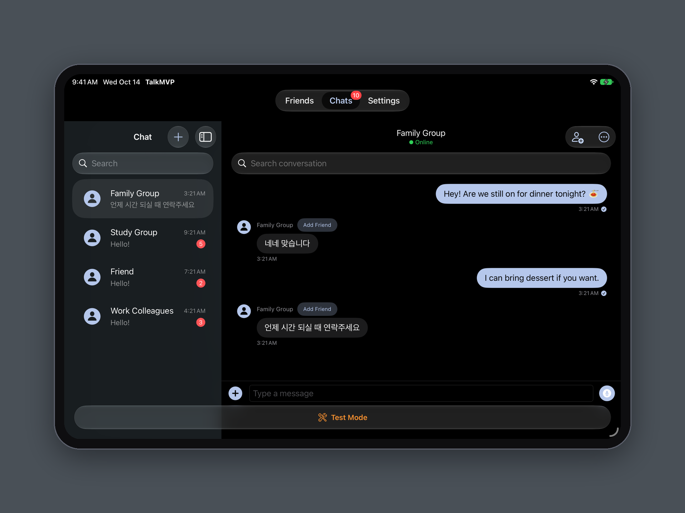
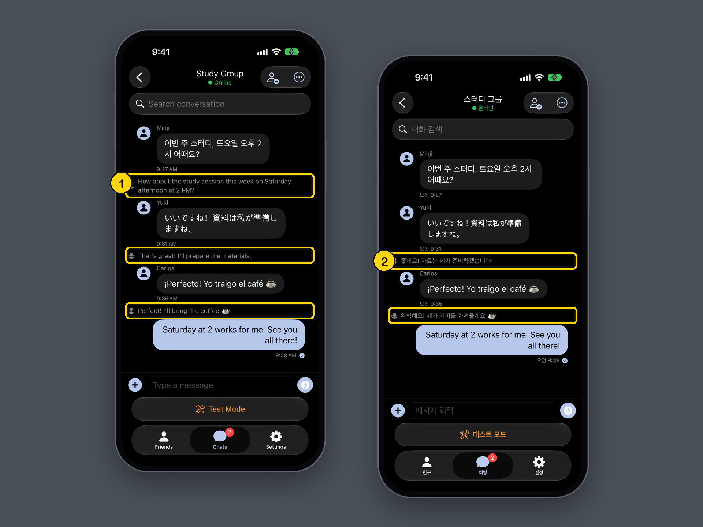
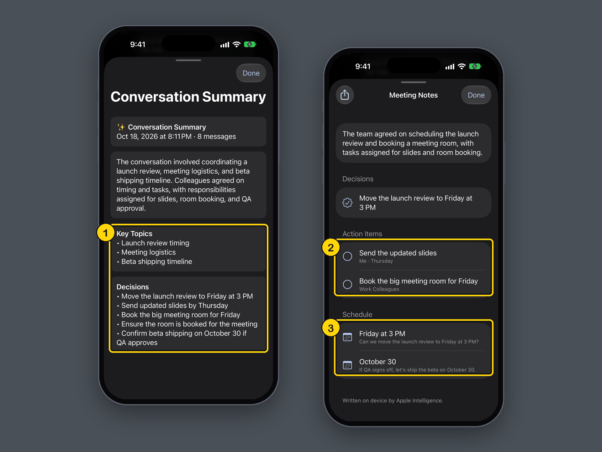
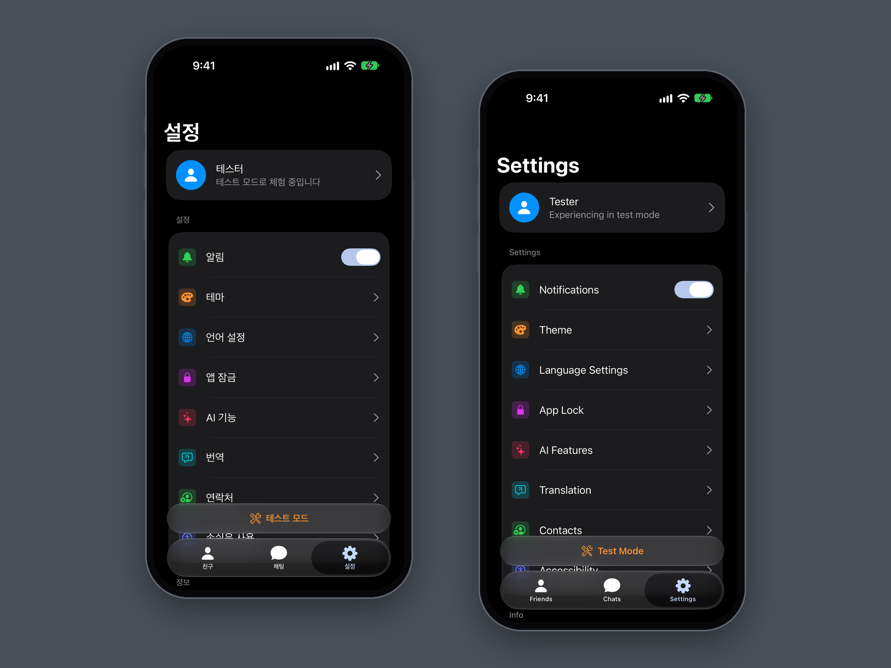
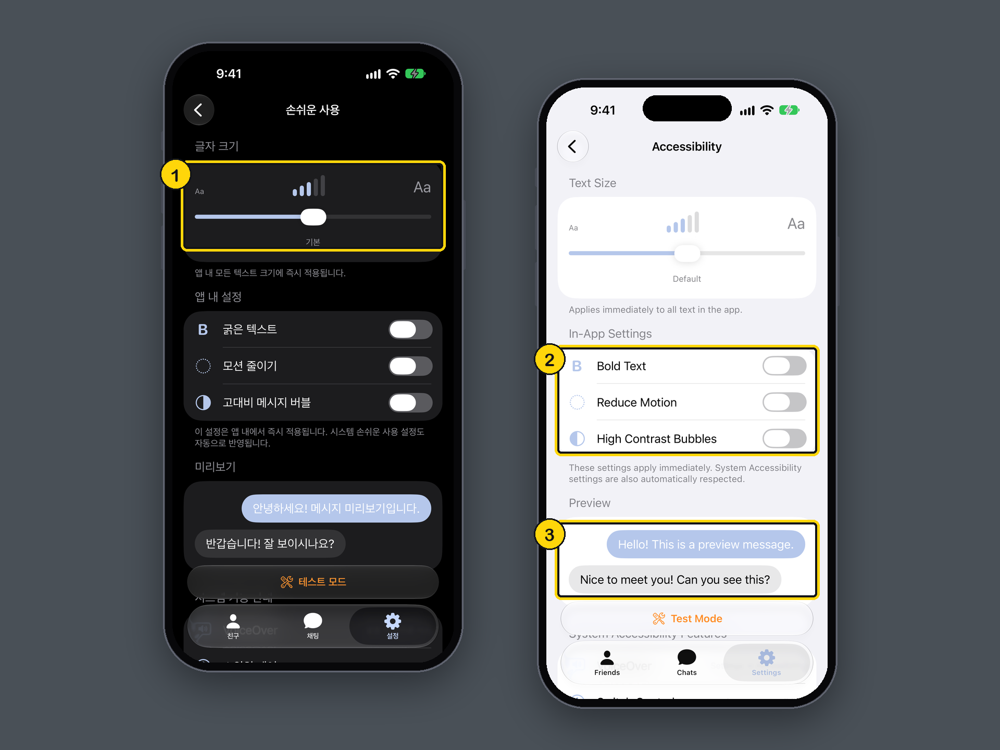
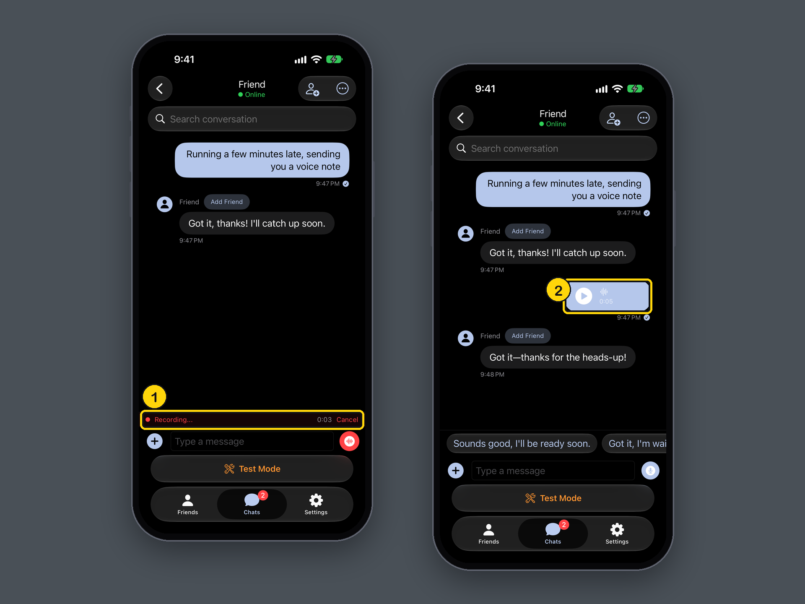

<div align="center">

# L!NK

**Messaging without borders. Minimal by design. Universal by nature.**


<br/>

_A messenger that gets out of your way — and breaks language barriers while it's at it._

<br/>



</div>

---

## The Problem

Modern messengers are exhausting.

Buttons everywhere. Tabs you never use. Reactions, stories, channels, bots, stickers — all fighting for your attention before you've even typed a word.

And if you want to talk to someone who speaks a different language? You're copy-pasting into a translation app and back. Every. Single. Time.

---

## The Solution

**L!NK** strips messaging down to what it actually is: two people talking.

Clean interface. No noise. And one feature that changes everything — **real-time auto-translation**, inline, right below every message.

Write in Korean. They write in Japanese. You both read in your own language.
No copy-paste. No switching apps. No awkward pauses.

Just conversation.

---

## Core Feature — Auto Translation

Turn it on once. Forget it's there.

> Original: Hola! ¿Cómo estás?  
> Translated: 안녕! 잘 지내? 🌐
>
> Original: 저도 잘 지내요! 오늘 뭐 해요?  
> Translated: I'm good too! What are you up to today? 🌐

Every message, automatically translated into your default language — inline, instantly, unobtrusively.

---

## Why "L!NK"

The exclamation mark isn't a typo.

It's the moment of connection — the spark when two people understand each other despite speaking different languages. L!NK is built to create that moment, again and again, for anyone, anywhere.

---

## Features

- **Minimal UI** — only what you need to send a message
- **Adaptive layout** — on iPad and an unfolded iPhone Duo the chat list stays beside the open conversation; on iPhone it collapses to a single column
- **Auto-translation** — inline and on device (Apple Translation framework), across Korean, English, Japanese, Chinese, Spanish, French and German
- **Multi-language app** — Korean, English, Japanese, Chinese, Spanish
- **Voice messages** — hold to record, tap to play, waveform display; what you said is written down on device under the message (Speech framework: SpeechAnalyzer with SpeechTranscriber, or DictationTranscriber on older devices), and the AI features read it too: the other side answers it, meeting notes and summaries include it, and search finds it
- **Attachments** — photos, videos, files and locations; files and videos open in Quick Look
- **Link previews** — rich metadata loaded automatically for URLs
- **Read receipts** — checkmark icons showing message delivery and read state
- **AI summary** — on-device summary of up to the last 300 messages (FoundationModels guided generation); a chat too long for the model to read at once is read in parts, with progress shown, and summarized from notes on each part
- **Meeting notes** — decisions, tasks with owners, dates and open questions from a chat, written on device by Apple Intelligence (guided generation). Every task has to quote the message it came from and is checked against the chat, so the model can't slip in a task nobody took on; dates are read by a date detector, not the model. Without Apple Intelligence, rules pick them out instead
- **Photo understanding (iOS 27)** — the on-device model looks at photos you send (Foundation Models image input) and writes a one-line description in your language, which VoiceOver reads, search finds, and the other side replies to; on iOS 26 photos work as before
- **Search by meaning** — search finds messages by their text, voice transcripts, photo descriptions and file names; with Apple Intelligence it also looks up related words and translations on device, so "저녁 약속" finds "dinner tonight", and it shows which words it added
- **Reply suggestions** — when someone writes, three short replies in the chat's language appear above the message field, written on device by Apple Intelligence; a tap puts one in the field to edit or send
- **Reactions & bookmarks** — emoji reactions and bookmarked messages
- **Disappearing messages** — auto-delete after a configurable duration
- **Scheduled send** — queue messages to send at a future time
- **App lock** — Face ID / Touch ID protection
- **Accessibility** — dynamic type, high contrast, screen reader support
- **Siri & Shortcuts** — "Send a message with TalkMVP" and "Summarize Family Group in TalkMVP" from Siri, Spotlight or Shortcuts, in Korean, English, Japanese, Chinese and Spanish (App Intents); nothing runs while signed out or while App Lock is on
- **Test mode** — try the app with sample friends and chats, no account needed
- **Replies in context** — the simulated other side answers what you actually said, in your language, written on device by Apple Intelligence; without it, a stock reply in your language

---

## Tech Stack

| Layer        | Technology                                                                 |
| ------------ | -------------------------------------------------------------------------- |
| Language     | Swift 6.2+ toolchain; Swift 5 language mode, MainActor default isolation   |
| UI Framework | SwiftUI — `NavigationSplitView` adaptive layout, Liquid Glass              |
| Architecture | MVVM + protocol-based repositories                                         |
| Persistence  | SwiftData; attachment files on disk                                        |
| On-device AI | FoundationModels (image input on iOS 27), Apple Translation framework, Speech (SpeechAnalyzer) |
| Tests        | Swift Testing (unit), XCTest UI tests on iPhone and iPad, AppIntentsTesting (iOS 27) |
| Platforms    | iOS and iPadOS 26+, built with the iOS 27 SDK                              |

---

## Screenshots

### Adaptive Layout (iPad)



### Translation



### AI Summary



### Settings



### Accessibility



### Voice Message



---

## Getting Started

### Requirements

- Xcode 26+ (developed and tested with Xcode 27)
- iOS or iPadOS 26+ (simulator or device)

### Run on an iPhone

1. Open `TalkMVP.xcodeproj`, select the **TalkMVP** target → **Signing & Capabilities**, and choose your team. With a free Apple ID, also change the bundle identifier to something unique.
2. Connect the iPhone, pick it as the run destination and press **Run**.
3. With a free (personal) team, iOS blocks the first launch until you trust the developer: **Settings → General → VPN & Device Management → your Apple ID → Trust**. Free provisioning profiles expire after 7 days; running from Xcode again renews them.
4. On the sign-in screen, **Try Test Mode** opens the app with sample friends and chats — no account needed.

### Tests

```bash
# Unit tests (Swift Testing)
xcodebuild test -project TalkMVP.xcodeproj -scheme TalkMVP \
  -destination 'platform=iOS Simulator,name=iPhone 17' -only-testing:TalkMVPTests

# UI tests — also run them on an iPad: the side-by-side layout test only runs in a regular-width window
xcodebuild test -project TalkMVP.xcodeproj -scheme TalkMVP \
  -destination 'platform=iOS Simulator,name=iPad mini (A17 Pro)' -only-testing:TalkMVPUITests

# Siri and Shortcuts, run end to end with AppIntentsTesting — needs an iOS 27 simulator
xcodebuild test -project TalkMVP.xcodeproj -scheme TalkMVP \
  -destination 'platform=iOS Simulator,name=iPhone 17' -only-testing:TalkMVPSiriUITests
```

---

## Project Structure

The app target has no feature subfolders yet — every view/service/model file sits flat inside `TalkMVP/` (a folder Xcode synchronizes into the target), with `Repositories/` as the one exception. This tree reflects the real, current layout:

```
link-mvp/
├── TalkMVP.xcodeproj/
├── TalkMVP/
│   ├── *.swift                  # ~60 files, flat (grouped by feature below)
│   ├── Repositories/
│   │   ├── AttachmentFileStore.swift
│   │   ├── ChatRoomRepository.swift
│   │   ├── MessageRepository.swift
│   │   ├── OrphanedDataCleaner.swift
│   │   └── TestAccount.swift
│   ├── AppShortcuts.xcstrings   # Siri phrases, in the app's five languages
│   ├── Localizable.xcstrings    # Siri and Shortcuts strings, in the same languages
│   └── Assets.xcassets/         # App icon, color sets, image assets
├── TalkMVPTests/
│   └── TalkMVPTests.swift       # Swift Testing suites
├── TalkMVPUITests/
│   ├── TalkMVPUITests.swift     # UI flows, on iPhone and iPad
│   └── TalkMVPUITestsLaunchTests.swift
├── TalkMVPSiriUITests/
│   └── SiriActionsUITests.swift # Siri actions run end to end with AppIntentsTesting (iOS 27 only)
└── docs/
    └── screenshots/             # Images used in this README (kept out of the app bundle)
```

**By feature** (logical grouping, not physical folders):

- **App**: `TalkMVPApp`, `ContentView`
- **Auth & App Lock**: `AuthView`, `AuthManager`, `SSOSignInView`, `GoogleOAuthService`, `AppLockView`, `AppLockManager`
- **Chat**: `ChatView` (+`Friends`/`Helpers`/`Input`/`Media`/`Messages`/`Sheets`), `ChatViewModel`, `ChatViewAlertModifiers`, `ChatViewSupportingViews`, `ChatListView`, `ChatRoom`, `ChatRoomBackgroundSettings`, `ChatService`/`ChatServiceProtocol`, `Message`, `MessageBubbleView`, `AttachmentPreviewer`, `TypingIndicatorView`, `ConnectionStatusView`, `MeetingNotesView`
- **Friends**: `FriendsView`, `FriendProfileView`, `FriendRowViews`, `FriendManagementViews`, `FriendSearchService`, `AddFriendView`, `OnboardingContactsView`, `ContactsSettingsView`, `ContactsSyncService`
- **Settings**: `SettingsView`, `SettingsCardComponents`, `AISettingsView`, `AIFeatureSettings`, `SecuritySettingsView`, `TranslationSettingsView`, `AccessibilitySettingsView`, `LanguageSettingsView`, `ThemeSettingsView`, `ProfileEditView`, `HelpView`, `TermsPoliciesView`, `AppInfoView`
- **Services & Managers**: `AIService`, `ConversationChunker`, `MeetingNotes`(+`Extractor`/`Grounding`), `MessageSearch`, `ConversationLanguage`, `LocalizationService`, `NotificationManager`, `AutoResponseService`, `ReplyWriter`, `ReplySuggestions`, `VoiceMessageService`, `VoiceTranscriber`, `PhotoDescriber`, `ChatIntents`, `ChatIntentActions`, `AttachmentHandler`
- **Localization**: `L10n`, `LanguageManager`(+`Extensions`)
- **Data Layer**: `Repositories/ChatRoomRepository`, `Repositories/MessageRepository`, `Repositories/AttachmentFileStore`, `Repositories/OrphanedDataCleaner`, `Repositories/TestAccount`, `User`
- **Shared**: `Colors+Extensions`

---

## License

Copyright © 2025–2026 David Song. All rights reserved.

This repository is published on GitHub for portfolio purposes. Being able to view the source does not grant any license to use it — no permission is given to copy, modify, distribute, or reuse this code, in whole or in part, including as training data for AI models, without prior written permission. Viewing and forking on GitHub are allowed only as GitHub's Terms of Service provide, and a fork grants no further rights. To ask for permission, contact [@mobssy](https://github.com/mobssy). See [LICENSE](LICENSE).

---

---

<div align="center">

# L!NK

**언어의 경계 없이. 미니멀하게 설계된. 모두를 위한 메신저.**


<br/>

_방해받지 않는 메신저 — 그리고 언어 장벽까지 없애줍니다._

<br/>


</div>

---

## 문제

요즘 메신저는 너무 피곤합니다.

버튼이 넘쳐나고, 쓰지도 않는 탭이 가득하고, 리액션, 스토리, 채널, 봇, 스티커 — 메시지 한 줄 보내기도 전에 이미 지칩니다.

다른 언어를 쓰는 사람과 대화하려면? 번역 앱을 왔다 갔다 하며 복사-붙여넣기를 반복해야 합니다. 매번.

---

## 해결책

**L!NK** 는 메시징을 본질로 되돌립니다: 두 사람의 대화.

깔끔한 인터페이스. 불필요한 요소 없음. 그리고 모든 걸 바꾸는 기능 하나 — **실시간 자동 번역**, 메시지 바로 아래에, 인라인으로.

한국어로 쓰세요. 상대방은 일본어로 답합니다. 둘 다 자신의 언어로 읽습니다.
복사-붙여넣기 없음. 앱 전환 없음. 어색한 침묵 없음.

그냥 대화입니다.

---

## 핵심 기능 — 자동 번역

한 번 켜두면, 있다는 것도 잊게 됩니다.

> 원문: Hola! ¿Cómo estás?  
> 번역: 안녕! 잘 지내? 🌐
>
> 원문: 저도 잘 지내요! 오늘 뭐 해요?  
> 번역: I'm good too! What are you up to today? 🌐

모든 메시지가 자동으로 내 기본 언어로 번역 — 인라인으로, 즉시, 조용하게.

---

## 왜 "L!NK" 인가

느낌표는 오타가 아닙니다.

그것은 연결의 순간 — 서로 다른 언어를 쓰는 두 사람이 서로를 이해하는 그 찰나입니다. L!NK는 그 순간을, 누구에게나, 어디서나, 계속 만들어내기 위해 만들어졌습니다.

---

## 주요 기능

- **미니멀 UI** — 메시지 보내는 데 필요한 것만
- **적응형 레이아웃** — iPad와 펼친 iPhone Duo에서는 채팅 목록과 대화가 나란히, 아이폰에서는 한 화면씩
- **자동 번역** — 메시지 바로 아래 인라인으로, 기기 안에서(Apple Translation 프레임워크) 한국어·영어·일본어·중국어·스페인어·프랑스어·독일어 번역
- **다국어 앱** — 한국어, 영어, 일본어, 중국어, 스페인어 지원
- **음성 메시지** — 꾹 눌러 녹음, 탭하여 재생, 파형 표시. 말한 내용을 기기 안에서 받아써 메시지 아래에 표시(Speech 프레임워크: SpeechAnalyzer + SpeechTranscriber, 구형 기기는 DictationTranscriber). AI 기능도 이 내용을 읽음: 상대방이 그 말에 답하고, 회의 노트·요약에 들어가고, 검색으로 찾을 수 있음
- **첨부** — 사진, 동영상, 파일, 위치; 파일과 동영상은 Quick Look으로 열기
- **링크 미리보기** — URL에 대한 풍부한 메타데이터 자동 로드
- **읽음 확인** — 메시지 전송 및 읽음 상태를 체크마크 아이콘으로 표시
- **AI 요약** — 최근 메시지 최대 300개를 기기 안에서 요약(FoundationModels 가이드 생성). 모델이 한 번에 못 읽는 긴 대화는 나눠 읽으며 진행 상황을 보여 주고, 부분별 메모를 모아 요약
- **회의 노트** — 대화의 결정 사항, 담당자가 있는 할 일, 일정, 남은 질문을 기기 안의 Apple Intelligence가 정리(가이드 생성). 할 일마다 근거 메시지를 인용하게 하고 대화와 대조해, 아무도 맡지 않은 할 일이 끼어들지 못하게 함. 일정은 모델이 아니라 날짜 감지기가 읽음. Apple Intelligence가 없으면 규칙 기반으로 추출
- **사진 이해(iOS 27)** — 보낸 사진을 기기 안의 모델이 보고(Foundation Models 이미지 입력) 내 언어로 한 줄 설명을 붙임. VoiceOver가 읽어 주고, 검색으로 찾을 수 있고, 상대방이 사진 내용에 답함. iOS 26에서는 기존과 동일
- **의미로 검색** — 메시지 글, 음성 받아쓰기, 사진 설명, 파일 이름으로 찾음. Apple Intelligence가 있으면 관련어와 번역어까지 기기 안에서 찾아 "저녁 약속"으로 "dinner tonight"도 찾고, 어떤 말로 함께 찾았는지 보여 줌
- **답장 추천** — 상대가 메시지를 보내면 대화 언어로 된 짧은 답장 3개가 입력창 위에 나타남(기기 안의 Apple Intelligence). 누르면 입력란에 들어가 고치거나 그대로 보낼 수 있음
- **리액션 & 북마크** — 이모지 리액션 및 메시지 북마크
- **자폭 메시지** — 설정한 시간 후 자동 삭제
- **예약 전송** — 원하는 시간에 메시지 예약 발송
- **앱 잠금** — Face ID / Touch ID 보호
- **접근성** — 다이나믹 타입, 고대비, 화면 낭독기 지원
- **Siri·단축어** — "TalkMVP로 메시지 보내기", "TalkMVP에서 가족 단톡방 요약해 줘"를 Siri, Spotlight, 단축어에서 한국어·영어·일본어·중국어·스페인어로 사용(App Intents). 로그아웃 상태나 앱 잠금이 켜져 있으면 실행하지 않음
- **테스트 모드** — 계정 없이 샘플 친구·채팅으로 바로 체험
- **맥락에 맞는 답장** — 시뮬레이션 상대방이 내가 실제로 한 말에 내 언어로 답함. 기기 안의 Apple Intelligence가 작성하고, 없으면 같은 언어의 기본 답장

---

## 기술 스택

| 레이어        | 기술                                                              |
| ------------- | ----------------------------------------------------------------- |
| 언어          | Swift 6.2+ 툴체인; Swift 5 언어 모드, 기본 격리 MainActor         |
| UI 프레임워크 | SwiftUI — `NavigationSplitView` 적응형 레이아웃, Liquid Glass     |
| 아키텍처      | MVVM + 프로토콜 기반 리포지토리                                   |
| 저장소        | SwiftData; 첨부 파일은 디스크에 저장                              |
| 온디바이스 AI | FoundationModels(iOS 27 이미지 입력), Apple Translation 프레임워크, Speech(SpeechAnalyzer) |
| 테스트        | Swift Testing(단위), XCTest UI 테스트(아이폰·iPad), AppIntentsTesting(iOS 27) |
| 플랫폼        | iOS·iPadOS 26+, iOS 27 SDK로 빌드                                 |

---

## 스크린샷

### 적응형 레이아웃 (iPad)


### 번역


### AI 요약


### 설정


### 접근성


### 음성 메시지


---

## 시작하기

### 요구사항

- Xcode 26+ (Xcode 27로 개발·테스트)
- iOS 또는 iPadOS 26+ (시뮬레이터 또는 실기기)

### 아이폰에서 실행하기

1. `TalkMVP.xcodeproj`를 열고 **TalkMVP** 타깃 → **Signing & Capabilities**에서 팀을 선택합니다. 무료 Apple ID라면 번들 ID도 고유한 값으로 바꿔 주세요.
2. 아이폰을 연결하고 실행 대상으로 선택한 뒤 **Run**을 누릅니다.
3. 무료(개인) 팀은 첫 실행 전에 기기에서 개발자를 신뢰해야 합니다: **설정 → 일반 → VPN 및 기기 관리 → 내 Apple ID → 신뢰**. 무료 프로비저닝 프로파일은 7일 후 만료되며, Xcode에서 다시 실행하면 갱신됩니다.
4. 로그인 화면의 **테스트 모드로 체험하기**를 누르면 계정 없이 샘플 친구·채팅과 함께 앱을 둘러볼 수 있습니다.

### 테스트

```bash
# 단위 테스트 (Swift Testing)
xcodebuild test -project TalkMVP.xcodeproj -scheme TalkMVP \
  -destination 'platform=iOS Simulator,name=iPhone 17' -only-testing:TalkMVPTests

# UI 테스트 — iPad에서도 돌려 주세요: 목록·대화 나란히 보기 테스트는 넓은 창에서만 실행됩니다
xcodebuild test -project TalkMVP.xcodeproj -scheme TalkMVP \
  -destination 'platform=iOS Simulator,name=iPad mini (A17 Pro)' -only-testing:TalkMVPUITests

# Siri·단축어 — AppIntentsTesting으로 끝까지 실행하며 iOS 27 시뮬레이터가 필요합니다
xcodebuild test -project TalkMVP.xcodeproj -scheme TalkMVP \
  -destination 'platform=iOS Simulator,name=iPhone 17' -only-testing:TalkMVPSiriUITests
```

---

## 프로젝트 구조

아직 기능별 하위 폴더는 없고, `Repositories/`를 제외한 모든 view/service/model 파일이 `TalkMVP/`(Xcode가 타깃에 자동 동기화하는 폴더) 밑에 flat하게 있습니다. 아래는 실제 배치 그대로입니다:

```
link-mvp/
├── TalkMVP.xcodeproj/
├── TalkMVP/
│   ├── *.swift                  # 약 60개 파일, flat (기능별 분류는 아래 참고)
│   ├── Repositories/
│   │   ├── AttachmentFileStore.swift
│   │   ├── ChatRoomRepository.swift
│   │   ├── MessageRepository.swift
│   │   ├── OrphanedDataCleaner.swift
│   │   └── TestAccount.swift
│   ├── AppShortcuts.xcstrings   # Siri 문구 (앱이 지원하는 5개 언어)
│   ├── Localizable.xcstrings    # Siri·단축어 문구 (같은 5개 언어)
│   └── Assets.xcassets/         # 앱 아이콘, 색상, 이미지 에셋
├── TalkMVPTests/
│   └── TalkMVPTests.swift       # Swift Testing 스위트
├── TalkMVPUITests/
│   ├── TalkMVPUITests.swift     # 아이폰·iPad UI 흐름 테스트
│   └── TalkMVPUITestsLaunchTests.swift
├── TalkMVPSiriUITests/
│   └── SiriActionsUITests.swift # AppIntentsTesting으로 Siri 동작을 끝까지 실행 (iOS 27 전용)
└── docs/
    └── screenshots/             # 이 README에 쓰인 이미지 (앱 번들에는 포함되지 않음)
```

**기능별 분류** (실제 폴더가 아닌 논리적 그룹입니다):

- **App**: `TalkMVPApp`, `ContentView`
- **Auth & 앱 잠금**: `AuthView`, `AuthManager`, `SSOSignInView`, `GoogleOAuthService`, `AppLockView`, `AppLockManager`
- **Chat**: `ChatView`(+`Friends`/`Helpers`/`Input`/`Media`/`Messages`/`Sheets`), `ChatViewModel`, `ChatViewAlertModifiers`, `ChatViewSupportingViews`, `ChatListView`, `ChatRoom`, `ChatRoomBackgroundSettings`, `ChatService`/`ChatServiceProtocol`, `Message`, `MessageBubbleView`, `AttachmentPreviewer`, `TypingIndicatorView`, `ConnectionStatusView`, `MeetingNotesView`
- **Friends**: `FriendsView`, `FriendProfileView`, `FriendRowViews`, `FriendManagementViews`, `FriendSearchService`, `AddFriendView`, `OnboardingContactsView`, `ContactsSettingsView`, `ContactsSyncService`
- **Settings**: `SettingsView`, `SettingsCardComponents`, `AISettingsView`, `AIFeatureSettings`, `SecuritySettingsView`, `TranslationSettingsView`, `AccessibilitySettingsView`, `LanguageSettingsView`, `ThemeSettingsView`, `ProfileEditView`, `HelpView`, `TermsPoliciesView`, `AppInfoView`
- **Services & Managers**: `AIService`, `ConversationChunker`, `MeetingNotes`(+`Extractor`/`Grounding`), `MessageSearch`, `ConversationLanguage`, `LocalizationService`, `NotificationManager`, `AutoResponseService`, `ReplyWriter`, `ReplySuggestions`, `VoiceMessageService`, `VoiceTranscriber`, `PhotoDescriber`, `ChatIntents`, `ChatIntentActions`, `AttachmentHandler`
- **Localization**: `L10n`, `LanguageManager`(+`Extensions`)
- **데이터 레이어**: `Repositories/ChatRoomRepository`, `Repositories/MessageRepository`, `Repositories/AttachmentFileStore`, `Repositories/OrphanedDataCleaner`, `Repositories/TestAccount`, `User`
- **공용**: `Colors+Extensions`

---

## 라이선스

Copyright © 2025–2026 David Song. All rights reserved.

이 저장소는 포트폴리오 목적으로 GitHub에 공개되어 있습니다. 소스를 열람할 수 있다는 것이 사용 권한을 의미하지는 않습니다 — 사전 서면 허가 없이 이 코드의 전체 또는 일부를 복사, 수정, 배포, 재사용하는 것은 허용되지 않으며, AI 모델 학습 데이터로 쓰는 것도 마찬가지입니다. GitHub에서의 열람과 포크는 GitHub 이용약관이 정한 범위에서만 허용되며, 포크했다고 해서 다른 권리가 생기지는 않습니다. 사용 허가는 [@mobssy](https://github.com/mobssy)로 문의해 주세요. 자세한 내용은 [LICENSE](LICENSE)를 참고하세요.
