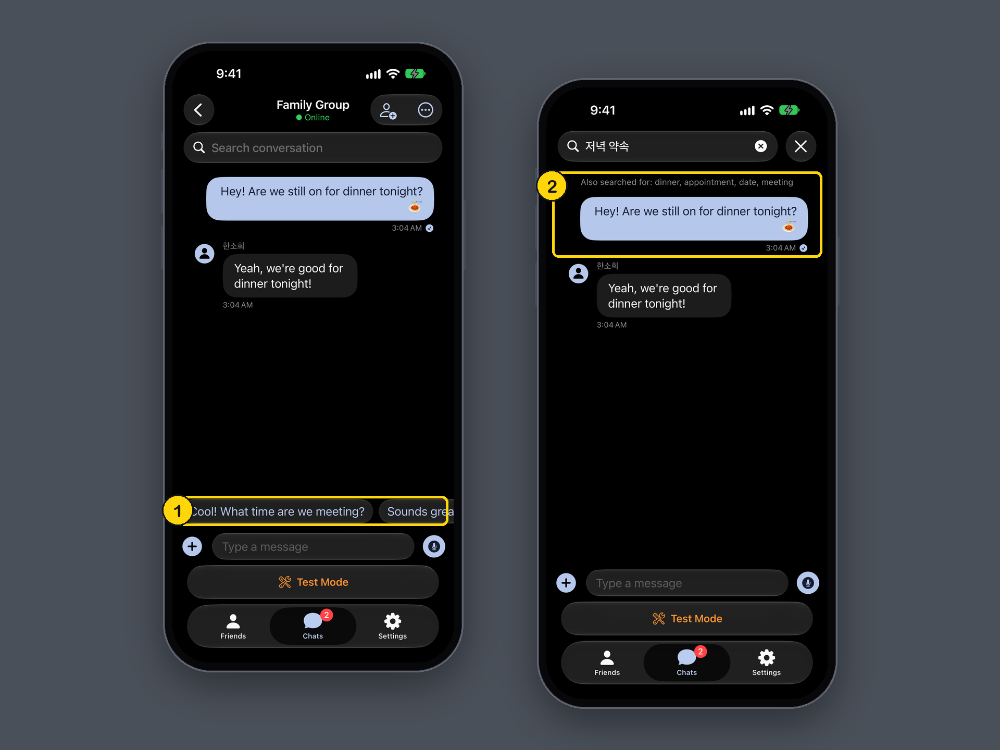

<div align="center">

# L!NK

**Messaging without borders. Minimal by design. Universal by nature.**


<br/>

_A messenger that gets out of your way — and breaks language barriers while it's at it._

<br/>


</div>

---

## The Problem

Modern messengers are exhausting.

Buttons everywhere. Tabs you never use. Reactions, stories, channels, bots, stickers — all fighting for your attention before you've even typed a word.

And if you want to talk to someone who speaks a different language? You're copy-pasting into a translation app and back. Every. Single. Time.

---

## The Solution

**L!NK** strips messaging down to what it actually is: two people talking.

Clean interface. No noise. And one feature that changes everything — **real-time auto-translation**, inline, right below every message.

Write in Korean. They write in Japanese. You both read in your own language.
No copy-paste. No switching apps. No awkward pauses.

Just conversation.

---

## Core Feature — Auto Translation

Turn it on once. Forget it's there.

> Original: Hola! ¿Cómo estás?  
> Translated: 안녕! 잘 지내? 🌐
>
> Original: 저도 잘 지내요! 오늘 뭐 해요?  
> Translated: I'm good too! What are you up to today? 🌐

Every message, automatically translated into your default language — inline, instantly, unobtrusively.

---

## Why "L!NK"

The exclamation mark isn't a typo.

It's the moment of connection — the spark when two people understand each other despite speaking different languages. L!NK is built to create that moment, again and again, for anyone, anywhere.

---

## Features

- **Minimal UI** — only what you need to send a message
- **Adaptive layout** — on iPad and an unfolded iPhone Duo the chat list stays beside the open conversation; on iPhone it collapses to a single column
- **Auto-translation** — inline and on device: Apple Intelligence (FoundationModels) where it's available, the Apple Translation framework otherwise; across Korean, English, Japanese, Chinese, Spanish, French and German
- **Multi-language app** — Korean, English, Japanese, Chinese, Spanish
- **Voice messages** — hold to record, tap to play, waveform display; what you said is written down on device under the message (Speech framework: SpeechAnalyzer with SpeechTranscriber, or DictationTranscriber on older devices), and the AI features read it too: the other side answers it, meeting notes and summaries include it, and search finds it
- **Attachments** — photos, videos, files and locations; files and videos open in Quick Look
- **Link previews** — rich metadata loaded automatically for URLs
- **Read receipts** — checkmark icons showing message delivery and read state
- **AI summary** — on-device summary of up to the last 300 messages (FoundationModels guided generation); a chat too long for the model to read at once is read in parts, with progress shown, and summarized from notes on each part
- **Meeting notes** — decisions, tasks with owners, dates and open questions from a chat, written on device by Apple Intelligence (guided generation). Every task has to quote the message it came from and is checked against the chat, so the model can't slip in a task nobody took on; dates are read by a date detector, not the model. Without Apple Intelligence, rules pick them out instead
- **Photo understanding (iOS 27)** — the on-device model looks at photos you send (Foundation Models image input) and writes a one-line description in your language, which VoiceOver reads, search finds, and the other side replies to; on iOS 26 photos work as before
- **Search by meaning** — search finds messages by their text, voice transcripts, photo descriptions and file names; with Apple Intelligence it also looks up related words and translations on device, so "저녁 약속" finds "dinner tonight", and it shows which words it added
- **Reply suggestions** — when someone writes, three short replies in the chat's language appear above the message field, written on device by Apple Intelligence; a tap puts one in the field to edit or send
- **Reactions & bookmarks** — emoji reactions and bookmarked messages
- **Disappearing messages** — auto-delete after a configurable duration
- **Scheduled send** — queue messages to send at a future time
- **App lock** — Face ID / Touch ID protection
- **Accessibility** — dynamic type, high contrast, screen reader support
- **Siri & Shortcuts** — "Send a message with TalkMVP" and "Summarize Family Group in TalkMVP" from Siri, Spotlight or Shortcuts, in Korean, English, Japanese, Chinese and Spanish (App Intents); nothing runs while signed out or while App Lock is on
- **Test mode** — try the app with sample friends and chats, no account needed
- **Replies in context** — the simulated other side answers what you actually said, in your language, written on device by Apple Intelligence; without it, a stock reply in your language

---

## Tech Stack

| Layer        | Technology                                                                 |
| ------------ | -------------------------------------------------------------------------- |
| Language     | Swift 6.4 toolchain (Xcode 27); Swift 5 language mode, MainActor default isolation |
| UI Framework | SwiftUI — `NavigationSplitView` adaptive layout, Liquid Glass              |
| Architecture | MVVM + protocol-based repositories                                         |
| Persistence  | SwiftData; attachment files on disk                                        |
| On-device AI | FoundationModels (image input on iOS 27), Apple Translation framework, Speech (SpeechAnalyzer) |
| Tests        | Swift Testing (unit), XCTest UI tests on iPhone and iPad, AppIntentsTesting (iOS 27) |
| Platforms    | iOS and iPadOS 26+, built with the iOS 27 SDK                              |

---

## Screenshots

The numbers in each image match the notes under it. The chats are test-mode sample data on the iOS 27 simulator; the AI text in them — translations, replies, summaries and notes — is real output of the on-device models.

### Inline Translation


1. Minji writes in Korean, Yuki in Japanese and Carlos in Spanish. With translation on, each message gets a line in your language underneath, translated on device.
2. The same chat with the app in Korean: the lines are now in Korean, and Minji's message, already in Korean, gets none.

### AI Summary & Meeting Notes


1. The summary: key topics and decisions, written on device by Apple Intelligence.
2. Action items, each with who took it on and by when. Every item quotes the message it came from and is checked against the chat.
3. Dates come from a date detector, not the model, with the message each one was found in.

### Reply Suggestions & Search by Meaning



1. Three short replies in the chat's language, written once the other side answers. A tap puts one in the message field.
2. Searching "저녁 약속" (dinner plans) finds "dinner tonight". Related words and translations are looked up on device, and the app shows which ones it added.

### Voice Messages


1. Hold the mic to record. The bar shows the time and a way to cancel; letting go sends the message.
2. The sent voice message, with its length. Speech recognition doesn't run in the simulator, so there's no transcript under it here.

### Adaptive Layout (iPad)


In a regular-width window the chat list stays beside the open conversation; on iPhone it collapses to one column.

### Accessibility


1. Text size applies to the whole app at once.
2. Bold text, reduced motion and high-contrast bubbles, on top of the system's own settings.
3. A preview of the bubbles with the current settings.

### Settings


Notifications, theme, language, app lock, the on-device AI features, translation, contacts and accessibility, in all five of the app's languages.

---

## Engineering Notes — What Took Iteration

L!NK has no backend: the other side of every chat is simulated, and every AI feature runs on the device's small on-device model. Most of the work went into making that model's output trustworthy in more than one language, and into keeping one codebase right on both iOS 26 and iOS 27. Each change below was tried on sample chats in Korean and English, with temporary probe tests that print the model's output, before it shipped. The commit messages tell each story in full.

### Making a small on-device model trustworthy

- **Meeting notes that don't invent tasks.** Early drafts padded the lists: "Should we invite Jordan?" became a task for the person who asked, and small talk about a hike became a to-do. Now each task has to quote the message it came from and say what that message does (a commitment, a request, a question), and the app keeps a task only when the quote is really in the chat. Owners come only from names the chat uses, and a request is never owned by its sender. Dates are read by `NSDataDetector`, not the model, after a bare "today" in a greeting was pinned to a noon nobody said. Six sample chats in English, Korean and both then came out with no invented tasks and no wrong owners.
- **Summaries of long chats.** The model reads about 4,000 tokens at once, so a long chat is cut into parts, the model takes notes on each part, and the summary is written from the notes, with the progress on screen. It took three rounds. Notes asked for as "four bullet points" copied each part's first lines. One summary of all the notes dwelt on how the chat began. And the model sometimes copied the prompt's own "[Write 2–3 sentences…]" placeholder, so the app now lays the summary out itself (guided generation). A 164-message trip-planning chat keeps both the dates settled at the start and the bookings made at the end.
- **One summary, two languages.** The English label for the reader's own messages, "Me", was read as a name ("Me will send the updated slides"). "You" fixed it; asking for the second person instead gave a stiff "당신" in Korean, so each language keeps its own label. Summary dates followed the device's region, so a Korean summary was dated in English; they now follow the app's language.
- **Replies in the right language.** The simulated other side used to answer from ten canned Korean lines ("Dinner at 7?" got "파일 잘 받았습니다 📄"). Now the on-device model answers what was said. Language detection needed guarding: on its own, "ok" was read as Polish and answered "Dobra.", and told to use "the user's language", the model picked Spanish. Detection is trusted only above 0.8 confidence, a short message is read together with earlier ones, and the app's language is the fallback.
- **Suggestions from the right side of the chat.** Suggested replies lost track of who was talking: "Congrats! When do you start?" got the suggestion "Congrats!". The transcript now marks Me and Them. An example answer in the prompt fixed it too, but then turned up word for word in unrelated chats, so it went.
- **Search by meaning across languages.** "저녁 약속" (dinner plans) should find "dinner tonight". Asked for related phrases, the model invented ones no message contains, so it returns single words. Asked for synonyms and translations together, it stayed in the search's language, so translations get a list of their own. And it translated the search as a whole ("dinner appointment"), so translations are matched word by word. The chat shows which words it added, so no match is a mystery.
- **Photo descriptions on iOS 27.** Asked in English for a Korean description, the model answered in English and then translated itself, so the request is now written in the language it should answer in. On iOS 26, photos work as before.
- **No translation beats a made-up one.** When neither Apple Intelligence nor the Translation framework could translate a message, the app fell back on a short phrasebook and on swapping Korean and English words one at a time, and showed the result as the translation. Now the line under the message says it couldn't translate.

### One codebase, iOS 26 and iOS 27

- **Swipe to reply.** `swipeActions` only works in a List, and the messages live in a ScrollView, so on iOS 26 a swipe to the right went to the system's swipe-back and left the chat. A SwiftUI drag gesture on the bubbles fixed the swipe but broke scrolling. The answer was a UIKit pan that starts only for a mostly sideways move to the right, which iOS 26's swipe-back waits for: a swipe on a bubble replies, and one beside it still goes back. Both were checked against the original behavior on iOS 26.5.
- **A test target that wouldn't load.** AppIntentsTesting (iOS 27) links a library iOS 26 doesn't have, and weak linking doesn't help when the framework itself is there, so the whole UI test bundle failed to load on iOS 26. The Siri tests moved to their own target, and the UI tests run on both versions again.
- **Staying on device.** Private Cloud Compute (iOS 27) could read a long chat in one go, but it needs a managed entitlement, and without one the first request crashes the app. Every AI feature stays on the device.

### SwiftUI state and concurrency

- **Sheets that showed stale results.** The meeting notes sheet opened on "Nothing to note yet" and stayed that way for seconds while the notes were being written. Its state lived in the chat view's `@State`, which only the sheet read, so setting it redrew nothing. It moved into an `@Observable` model the sheets read directly. The UI test written for it failed before the fix and passes after.
- **SwiftData across actors.** Summaries read SwiftData messages on the AI service's actor, racing with a disappearing message being deleted on the main thread. Swift 5 mode didn't flag it; the chat now hands the AI a `Sendable` copy.
- **A recording that froze the chat.** Holding the mic froze the whole chat: the audio session was switched on on the main thread, and the recorder switched it on again by itself when it started. In the simulator a 9-second press took over a minute to come back. Both now run off the main thread (`@concurrent`), and letting go before the recording has started calls it off cleanly.
- **Work nobody saw.** With translation on, every incoming message was translated twice, once for a dictionary nothing read, and every sent message once for nothing. That was real on-device inference; it's gone.

### Checking what the simulator can't

- Speech recognition doesn't run in the iOS simulator, so the transcription pipeline was checked on macOS with the same code: synthesized English and Korean sentences came back word for word. A test there caught the end of the audio being cut at a 1,024-frame boundary.
- The UI tests run on iPhone (iOS 26.5 and 27) and iPad, and the Siri actions run end to end through the system with AppIntentsTesting.

---

## Getting Started

### Requirements

- Xcode 27+ — building needs the iOS 27 SDK: photo descriptions use Foundation Models image input, and the Siri tests use AppIntentsTesting
- iOS or iPadOS 26+ to run (simulator or device)

### Run on an iPhone

1. Open `TalkMVP.xcodeproj`, select the **TalkMVP** target → **Signing & Capabilities**, and choose your team. With a free Apple ID, also change the bundle identifier to something unique.
2. Connect the iPhone, pick it as the run destination and press **Run**.
3. With a free (personal) team, iOS blocks the first launch until you trust the developer: **Settings → General → VPN & Device Management → your Apple ID → Trust**. Free provisioning profiles expire after 7 days; running from Xcode again renews them.
4. On the sign-in screen, **Try Test Mode** opens the app with sample friends and chats — no account needed.

### Tests

```bash
# Unit tests (Swift Testing)
xcodebuild test -project TalkMVP.xcodeproj -scheme TalkMVP \
  -destination 'platform=iOS Simulator,name=iPhone 17' -only-testing:TalkMVPTests

# UI tests — also run them on an iPad: the side-by-side layout test only runs in a regular-width window
xcodebuild test -project TalkMVP.xcodeproj -scheme TalkMVP \
  -destination 'platform=iOS Simulator,name=iPad mini (A17 Pro)' -only-testing:TalkMVPUITests

# Siri and Shortcuts, run end to end with AppIntentsTesting — needs an iOS 27 simulator
xcodebuild test -project TalkMVP.xcodeproj -scheme TalkMVP \
  -destination 'platform=iOS Simulator,name=iPhone 17' -only-testing:TalkMVPSiriUITests
```

---

## Project Structure

The app target has no feature subfolders yet — every view/service/model file sits flat inside `TalkMVP/` (a folder Xcode synchronizes into the target), with `Repositories/` as the one exception. This tree reflects the real, current layout:

```
link-mvp/
├── TalkMVP.xcodeproj/
├── TalkMVP/
│   ├── *.swift                  # ~75 files, flat (grouped by feature below)
│   ├── Repositories/
│   │   ├── AttachmentFileStore.swift
│   │   ├── ChatRoomRepository.swift
│   │   ├── MessageRepository.swift
│   │   ├── OrphanedDataCleaner.swift
│   │   └── TestAccount.swift
│   ├── AppShortcuts.xcstrings   # Siri phrases, in the app's five languages
│   ├── Localizable.xcstrings    # Siri and Shortcuts strings, in the same languages (the UI is localized in code)
│   └── Assets.xcassets/         # App icon, color sets, image assets
├── TalkMVPTests/
│   └── TalkMVPTests.swift       # Swift Testing suites
├── TalkMVPUITests/
│   ├── TalkMVPUITests.swift     # UI flows, on iPhone and iPad
│   └── TalkMVPUITestsLaunchTests.swift
├── TalkMVPSiriUITests/
│   └── SiriActionsUITests.swift # Siri actions run end to end with AppIntentsTesting (iOS 27 only)
└── docs/
    └── screenshots/             # Images used in this README (kept out of the app bundle)
```

**By feature** (logical grouping, not physical folders):

- **App**: `TalkMVPApp`, `ContentView`
- **Auth & App Lock**: `AuthView`, `AuthManager`, `SSOSignInView`, `GoogleOAuthService`, `AppLockView`, `AppLockManager`
- **Chat**: `ChatView` (+`Friends`/`Helpers`/`Input`/`Media`/`Messages`/`Sheets`), `ChatViewModel`, `ChatAIResults`, `ChatViewAlertModifiers`, `ChatViewSupportingViews`, `ChatListView`, `ChatRoom`, `ChatRoomBackgroundSettings`, `ChatService`/`ChatServiceProtocol`, `OpenChatRooms`, `Message`, `MessageBubbleView`, `SwipeToReply`, `AttachmentPreviewer`, `TypingIndicatorView`, `ConnectionStatusView`, `MeetingNotesView`
- **Friends**: `FriendsView`, `FriendProfileView`, `FriendRowViews`, `FriendManagementViews`, `FriendSearchService`, `AddFriendView`, `OnboardingContactsView`, `ContactsSettingsView`, `ContactsSyncService`
- **Settings**: `SettingsView`, `SettingsCardComponents`, `AISettingsView`, `AIFeatureSettings`, `SecuritySettingsView`, `TranslationSettingsView`, `AccessibilitySettingsView`, `LanguageSettingsView`, `ThemeSettingsView`, `ProfileEditView`, `HelpView`, `TermsPoliciesView`, `AppInfoView`
- **Services & Managers**: `AIService`, `ConversationChunker`, `MeetingNotes`(+`Extractor`/`Grounding`), `MessageSearch`, `ConversationLanguage`, `LocalizationService`, `NotificationManager`, `AutoResponseService`, `ReplyWriter`, `ReplySuggestions`, `MessageTranslation`, `VoiceMessageService`, `VoiceTranscriber`, `PhotoDescriber`, `ChatIntents`, `ChatIntentActions`, `AttachmentHandler`
- **Localization**: `L10n`, `LanguageManager`(+`Extensions`)
- **Data Layer**: `Repositories/ChatRoomRepository`, `Repositories/MessageRepository`, `Repositories/AttachmentFileStore`, `Repositories/OrphanedDataCleaner`, `Repositories/TestAccount`, `User`
- **Shared**: `Colors+Extensions`

---

## License

Copyright © 2025–2026 David Song. All rights reserved.

This repository is published on GitHub for portfolio purposes. Being able to view the source does not grant any license to use it — no permission is given to copy, modify, distribute, or reuse this code, in whole or in part, including as training data for AI models, without prior written permission. Viewing and forking on GitHub are allowed only as GitHub's Terms of Service provide, and a fork grants no further rights. To ask for permission, contact [@mobssy](https://github.com/mobssy). See [LICENSE](LICENSE).

---

---

<div align="center">

# L!NK

**언어의 경계 없이. 미니멀하게 설계된. 모두를 위한 메신저.**


<br/>

_방해받지 않는 메신저 — 그리고 언어 장벽까지 없애줍니다._

<br/>


</div>

---

## 문제

요즘 메신저는 너무 피곤합니다.

버튼이 넘쳐나고, 쓰지도 않는 탭이 가득하고, 리액션, 스토리, 채널, 봇, 스티커 — 메시지 한 줄 보내기도 전에 이미 지칩니다.

다른 언어를 쓰는 사람과 대화하려면? 번역 앱을 왔다 갔다 하며 복사-붙여넣기를 반복해야 합니다. 매번.

---

## 해결책

**L!NK** 는 메시징을 본질로 되돌립니다: 두 사람의 대화.

깔끔한 인터페이스. 불필요한 요소 없음. 그리고 모든 걸 바꾸는 기능 하나 — **실시간 자동 번역**, 메시지 바로 아래에, 인라인으로.

한국어로 쓰세요. 상대방은 일본어로 답합니다. 둘 다 자신의 언어로 읽습니다.
복사-붙여넣기 없음. 앱 전환 없음. 어색한 침묵 없음.

그냥 대화입니다.

---

## 핵심 기능 — 자동 번역

한 번 켜두면, 있다는 것도 잊게 됩니다.

> 원문: Hola! ¿Cómo estás?  
> 번역: 안녕! 잘 지내? 🌐
>
> 원문: 저도 잘 지내요! 오늘 뭐 해요?  
> 번역: I'm good too! What are you up to today? 🌐

모든 메시지가 자동으로 내 기본 언어로 번역 — 인라인으로, 즉시, 조용하게.

---

## 왜 "L!NK" 인가

느낌표는 오타가 아닙니다.

그것은 연결의 순간 — 서로 다른 언어를 쓰는 두 사람이 서로를 이해하는 그 찰나입니다. L!NK는 그 순간을, 누구에게나, 어디서나, 계속 만들어내기 위해 만들어졌습니다.

---

## 주요 기능

- **미니멀 UI** — 메시지 보내는 데 필요한 것만
- **적응형 레이아웃** — iPad와 펼친 iPhone Duo에서는 채팅 목록과 대화가 나란히, 아이폰에서는 한 화면씩
- **자동 번역** — 메시지 바로 아래 인라인으로, 기기 안에서 번역: Apple Intelligence(FoundationModels)가 있으면 그것으로, 없으면 Apple Translation 프레임워크로. 한국어·영어·일본어·중국어·스페인어·프랑스어·독일어
- **다국어 앱** — 한국어, 영어, 일본어, 중국어, 스페인어 지원
- **음성 메시지** — 꾹 눌러 녹음, 탭하여 재생, 파형 표시. 말한 내용을 기기 안에서 받아써 메시지 아래에 표시(Speech 프레임워크: SpeechAnalyzer + SpeechTranscriber, 구형 기기는 DictationTranscriber). AI 기능도 이 내용을 읽음: 상대방이 그 말에 답하고, 회의 노트·요약에 들어가고, 검색으로 찾을 수 있음
- **첨부** — 사진, 동영상, 파일, 위치; 파일과 동영상은 Quick Look으로 열기
- **링크 미리보기** — URL에 대한 풍부한 메타데이터 자동 로드
- **읽음 확인** — 메시지 전송 및 읽음 상태를 체크마크 아이콘으로 표시
- **AI 요약** — 최근 메시지 최대 300개를 기기 안에서 요약(FoundationModels 가이드 생성). 모델이 한 번에 못 읽는 긴 대화는 나눠 읽으며 진행 상황을 보여 주고, 부분별 메모를 모아 요약
- **회의 노트** — 대화의 결정 사항, 담당자가 있는 할 일, 일정, 남은 질문을 기기 안의 Apple Intelligence가 정리(가이드 생성). 할 일마다 근거 메시지를 인용하게 하고 대화와 대조해, 아무도 맡지 않은 할 일이 끼어들지 못하게 함. 일정은 모델이 아니라 날짜 감지기가 읽음. Apple Intelligence가 없으면 규칙 기반으로 추출
- **사진 이해(iOS 27)** — 보낸 사진을 기기 안의 모델이 보고(Foundation Models 이미지 입력) 내 언어로 한 줄 설명을 붙임. VoiceOver가 읽어 주고, 검색으로 찾을 수 있고, 상대방이 사진 내용에 답함. iOS 26에서는 기존과 동일
- **의미로 검색** — 메시지 글, 음성 받아쓰기, 사진 설명, 파일 이름으로 찾음. Apple Intelligence가 있으면 관련어와 번역어까지 기기 안에서 찾아 "저녁 약속"으로 "dinner tonight"도 찾고, 어떤 말로 함께 찾았는지 보여 줌
- **답장 추천** — 상대가 메시지를 보내면 대화 언어로 된 짧은 답장 3개가 입력창 위에 나타남(기기 안의 Apple Intelligence). 누르면 입력란에 들어가 고치거나 그대로 보낼 수 있음
- **리액션 & 북마크** — 이모지 리액션 및 메시지 북마크
- **자폭 메시지** — 설정한 시간 후 자동 삭제
- **예약 전송** — 원하는 시간에 메시지 예약 발송
- **앱 잠금** — Face ID / Touch ID 보호
- **접근성** — 다이나믹 타입, 고대비, 화면 낭독기 지원
- **Siri·단축어** — "TalkMVP로 메시지 보내기", "TalkMVP에서 가족 단톡방 요약해 줘"를 Siri, Spotlight, 단축어에서 한국어·영어·일본어·중국어·스페인어로 사용(App Intents). 로그아웃 상태나 앱 잠금이 켜져 있으면 실행하지 않음
- **테스트 모드** — 계정 없이 샘플 친구·채팅으로 바로 체험
- **맥락에 맞는 답장** — 시뮬레이션 상대방이 내가 실제로 한 말에 내 언어로 답함. 기기 안의 Apple Intelligence가 작성하고, 없으면 같은 언어의 기본 답장

---

## 기술 스택

| 레이어        | 기술                                                              |
| ------------- | ----------------------------------------------------------------- |
| 언어          | Swift 6.4 툴체인(Xcode 27); Swift 5 언어 모드, 기본 격리 MainActor |
| UI 프레임워크 | SwiftUI — `NavigationSplitView` 적응형 레이아웃, Liquid Glass     |
| 아키텍처      | MVVM + 프로토콜 기반 리포지토리                                   |
| 저장소        | SwiftData; 첨부 파일은 디스크에 저장                              |
| 온디바이스 AI | FoundationModels(iOS 27 이미지 입력), Apple Translation 프레임워크, Speech(SpeechAnalyzer) |
| 테스트        | Swift Testing(단위), XCTest UI 테스트(아이폰·iPad), AppIntentsTesting(iOS 27) |
| 플랫폼        | iOS·iPadOS 26+, iOS 27 SDK로 빌드                                 |

---

## 스크린샷

이미지 속 번호는 아래 설명의 번호와 같습니다. 대화는 iOS 27 시뮬레이터의 테스트 모드 샘플 데이터이고, 그 안의 AI 문장(번역, 답장, 요약, 노트)은 기기 안 모델이 실제로 만든 결과입니다.

### 인라인 번역


1. 민지는 한국어로, Yuki는 일본어로, Carlos는 스페인어로 씁니다. 번역을 켜면 메시지마다 아래에 내 언어로 된 번역이 기기 안에서 붙습니다.
2. 같은 대화를 한국어 앱에서 보면 번역이 한국어로 바뀌고, 이미 한국어인 민지의 메시지에는 붙지 않습니다.

### AI 요약 · 회의 노트


1. 요약: 주요 주제와 결정 사항을 기기 안의 Apple Intelligence가 작성합니다.
2. 할 일마다 누가 맡았는지, 언제까지인지 적습니다. 모든 항목은 근거 메시지를 인용하고 대화와 대조합니다.
3. 일정은 모델이 아니라 날짜 감지기가 찾고, 찾은 메시지를 함께 보여 줍니다.

### 추천 답장 · 의미로 검색


1. 상대가 답하면 대화 언어로 된 짧은 답장 3개가 나타납니다. 누르면 입력란에 들어갑니다.
2. "저녁 약속"으로 검색하면 "dinner tonight"을 찾습니다. 관련어와 번역어를 기기 안에서 찾고, 어떤 말을 더했는지 보여 줍니다.

### 음성 메시지


1. 마이크를 누르고 있는 동안 녹음합니다. 막대에 녹음 시간과 취소 버튼이 보이고, 손을 떼면 보냅니다.
2. 보낸 음성 메시지와 길이입니다. 시뮬레이터에서는 음성 인식이 돌지 않아, 이 화면에는 아래에 받아쓰기가 없습니다.

### 적응형 레이아웃 (iPad)


넓은 창에서는 채팅 목록이 열린 대화 옆에 그대로 남고, 아이폰에서는 한 화면씩 보입니다.

### 접근성


1. 글자 크기는 앱 전체에 바로 적용됩니다.
2. 굵은 텍스트, 동작 줄이기, 고대비 말풍선을 시스템 설정과 별도로 켤 수 있습니다.
3. 지금 설정으로 말풍선이 어떻게 보이는지 미리 보여 줍니다.

### 설정


알림, 테마, 언어, 앱 잠금, 기기 안 AI 기능, 번역, 연락처, 접근성을 앱이 지원하는 5개 언어로 제공합니다.

---

## 개발 노트 — 고민하고 다듬은 것들

L!NK에는 서버가 없습니다. 모든 대화의 상대방은 시뮬레이션이고, 모든 AI 기능은 기기 안의 작은 온디바이스 모델에서 돌아갑니다. 그래서 작업 대부분은 이 모델의 출력을 여러 언어에서 믿을 만하게 만드는 일과, 하나의 코드로 iOS 26과 iOS 27을 모두 제대로 지원하는 일에 들어갔습니다. 아래의 변경은 모두 모델 출력을 찍어 보는 임시 프로브 테스트로 한국어·영어 샘플 대화에 먼저 돌려 본 뒤 반영했습니다. 자세한 과정은 각 커밋 메시지에 남아 있습니다.

### 작은 온디바이스 모델을 믿을 수 있게 만들기

- **없는 할 일을 지어내지 않는 회의 노트.** 처음에는 모델이 목록을 부풀렸습니다. "Should we invite Jordan?"이라는 질문이 질문한 사람의 할 일이 되고, 등산 이야기 같은 잡담이 할 일로 들어갔습니다. 이제 할 일마다 근거가 된 메시지를 인용하고 그 메시지가 무엇인지(약속, 요청, 질문)를 밝혀야 하며, 인용이 실제로 대화에 있을 때만 남깁니다. 담당자는 대화에 나온 이름으로만 정하고, 요청한 사람이 그 요청의 담당자가 되지 않게 했습니다. 인사말 속 "오늘"이 아무도 말하지 않은 정오로 고정되는 일이 있어서, 날짜는 모델이 아니라 `NSDataDetector`가 읽습니다. 그 뒤 영어·한국어·혼용 샘플 대화 6개에서 지어낸 할 일도, 잘못된 담당자도 나오지 않았습니다.
- **긴 대화의 요약.** 모델은 한 번에 약 4,000토큰만 읽기 때문에, 긴 대화는 여러 부분으로 나눠 부분마다 메모를 받고 그 메모로 요약을 쓰며 진행 상황을 화면에 보여 줍니다. 여기까지 세 번을 고쳤습니다. "글머리표 4개"로 메모를 요청하자 부분마다 첫 줄만 베꼈습니다. 메모 전체를 한 번에 요약하게 하자 대화 초반 이야기에만 머물렀습니다. 모델이 프롬프트의 "[2~3문장으로 쓰세요…]" 자리 표시까지 그대로 옮겨 적는 일도 있어서, 요약의 구성은 이제 앱이 직접 잡습니다(가이드 생성). 메시지 164개짜리 여행 계획 대화에서 처음에 정한 날짜와 마지막의 예약 내용이 모두 요약에 들어갑니다.
- **요약 하나, 두 언어.** 영어 요약에서 내 메시지에 붙인 "Me"를 모델이 이름으로 읽어 "Me will send the updated slides"라고 썼습니다. "You"로 바꾸자 해결됐습니다. 대신 2인칭으로 쓰라고 하면 한국어에서 딱딱한 "당신"이 나와서, 언어마다 각자의 표현을 씁니다. 요약 날짜는 기기 지역 설정을 따라 한국어 요약에 영어 날짜가 붙었는데, 이제 앱 언어를 따릅니다.
- **맞는 언어로 하는 답장.** 시뮬레이션 상대방은 원래 한국어 기본 문장 10개 중에서 골라 답했습니다("Dinner at 7?"에 "파일 잘 받았습니다 📄"). 이제는 기기 안의 모델이 실제로 한 말에 답합니다. 언어 감지에는 안전장치가 필요했습니다. "ok" 한 단어는 폴란드어로 인식돼 "Dobra."라는 답이 나왔고, "사용자의 언어로" 답하라고 하자 모델은 스페인어를 골랐습니다. 이제 감지 결과는 신뢰도 0.8 이상일 때만 쓰고, 짧은 메시지는 앞선 메시지와 함께 읽으며, 그래도 모르면 앱 언어를 씁니다.
- **대화의 맞은편에서 고르는 추천 답장.** 추천 답장이 누가 말하는지를 놓쳐서, "Congrats! When do you start?"에 "Congrats!"를 추천했습니다. 이제 대화록에 나와 상대를 표시합니다. 프롬프트에 예시 답을 넣어도 고쳐지긴 했지만, 그 예시가 상관없는 대화에 글자 그대로 나타나서 뺐습니다.
- **언어를 넘나드는 의미 검색.** "저녁 약속"으로 "dinner tonight"을 찾아야 합니다. 관련 표현을 달라고 하자 모델은 어떤 메시지에도 없는 표현을 지어내서, 이제 한 단어씩 받습니다. 유의어와 번역어를 함께 달라고 하자 검색어의 언어에만 머물러서, 번역어는 따로 받습니다. 검색어를 통째로 번역하는 문제("dinner appointment")도 있어서, 번역어는 단어 단위로 맞춰 봅니다. 무엇을 더해 찾았는지 화면에 보여 주므로 왜 그 메시지가 찾아졌는지 알 수 있습니다.
- **iOS 27의 사진 설명.** 영어로 쓴 요청에 한국어 설명을 달라고 하자 모델은 영어로 답한 뒤 스스로 번역했습니다. 그래서 요청 자체를 답해야 할 언어로 씁니다. iOS 26에서는 사진이 예전처럼 동작합니다.
- **지어낸 번역보다는 번역 없음.** Apple Intelligence와 Translation 프레임워크가 둘 다 번역하지 못하면, 예전에는 짧은 인사말 사전과 한국어·영어 단어를 하나씩 바꿔 끼운 결과를 번역처럼 보여 줬습니다. 이제는 메시지 아래에 번역할 수 없었다고 표시합니다.

### 하나의 코드로 iOS 26과 iOS 27 지원하기

- **밀어서 답장.** `swipeActions`는 List에서만 동작하는데 메시지는 ScrollView 안에 있어서, iOS 26에서는 오른쪽으로 밀면 시스템의 뒤로 가기가 받아 채팅방을 나가 버렸습니다. 말풍선에 SwiftUI 드래그 제스처를 달자 밀기는 되었지만 스크롤이 막혔습니다. 결국 오른쪽으로, 주로 옆으로 움직일 때만 시작하는 UIKit 팬 제스처를 쓰고, iOS 26의 뒤로 가기가 이 제스처를 기다리게 했습니다. 말풍선에서 밀면 답장이 되고, 말풍선 옆에서 밀면 여전히 뒤로 갑니다. 두 경우 모두 iOS 26.5에서 원래 동작과 비교해 확인했습니다.
- **로드되지 않던 테스트 타깃.** AppIntentsTesting(iOS 27)은 iOS 26에 없는 라이브러리를 링크합니다. 프레임워크 자체는 있기 때문에 약한 링크로도 해결되지 않아, iOS 26에서 UI 테스트 번들 전체가 로드되지 않았습니다. Siri 테스트를 별도 타깃으로 옮겨 UI 테스트가 다시 두 버전에서 돌아갑니다.
- **기기 안에서만.** iOS 27의 Private Cloud Compute는 긴 대화를 한 번에 읽을 수 있지만 별도 승인이 필요한 권한이 있어야 하고, 권한 없이 첫 요청을 보내면 앱이 종료됩니다. 그래서 모든 AI 기능은 기기 안에서만 돌아갑니다.

### SwiftUI 상태와 동시성

- **지난 결과를 보여 주던 시트.** 회의 노트 시트가 노트를 쓰는 동안 몇 초씩 "정리할 내용이 아직 없어요"로 열려 있었습니다. 상태가 채팅 화면의 `@State`에 있었는데 시트만 그 값을 읽어서, 값이 바뀌어도 화면이 다시 그려지지 않았습니다. 시트가 직접 읽는 `@Observable` 모델로 옮겼고, 이를 위해 쓴 UI 테스트는 수정 전에는 실패하고 수정 후에는 통과합니다.
- **액터를 넘나드는 SwiftData.** 요약이 AI 서비스의 액터에서 SwiftData 메시지를 읽어서, 메인 스레드에서 자폭 메시지가 지워지는 순간과 경합했습니다. Swift 5 언어 모드에서는 경고가 나지 않았고, 이제 채팅 화면이 `Sendable` 복사본을 넘깁니다.
- **채팅을 멈추게 한 녹음.** 마이크를 누르고 있으면 채팅 전체가 멈췄습니다. 오디오 세션을 메인 스레드에서 켰고, 녹음기도 시작하면서 세션을 스스로 한 번 더 켰기 때문입니다. 시뮬레이터에서는 9초 누르기가 1분 넘게 걸렸습니다. 이제 둘 다 메인 스레드 밖(`@concurrent`)에서 돌고, 녹음이 시작되기 전에 손을 떼도 깔끔하게 취소됩니다.
- **아무도 보지 않던 작업.** 번역을 켜면 받은 메시지마다 번역이 두 번 돌았습니다. 한 번은 아무도 읽지 않는 딕셔너리를 채우는 용도였고, 보낸 메시지도 쓸데없이 한 번씩 번역됐습니다. 실제 온디바이스 추론이었고, 이제 없앴습니다.

### 시뮬레이터가 못 하는 것 확인하기

- 음성 인식은 iOS 시뮬레이터에서 돌지 않아서, 받아쓰기 과정은 같은 코드로 macOS에서 확인했습니다. 합성한 영어·한국어 문장이 글자 그대로 돌아왔고, 이때 테스트가 오디오 끝이 1,024프레임 경계에서 잘리는 문제를 잡아냈습니다.
- UI 테스트는 아이폰(iOS 26.5, 27)과 iPad에서 돌고, Siri 동작은 AppIntentsTesting으로 시스템을 거쳐 끝까지 실행합니다.

---

## 시작하기

### 요구사항

- Xcode 27+ — 빌드에 iOS 27 SDK가 필요합니다: 사진 설명은 Foundation Models 이미지 입력을, Siri 테스트는 AppIntentsTesting을 씁니다
- 실행은 iOS 또는 iPadOS 26+ (시뮬레이터 또는 실기기)

### 아이폰에서 실행하기

1. `TalkMVP.xcodeproj`를 열고 **TalkMVP** 타깃 → **Signing & Capabilities**에서 팀을 선택합니다. 무료 Apple ID라면 번들 ID도 고유한 값으로 바꿔 주세요.
2. 아이폰을 연결하고 실행 대상으로 선택한 뒤 **Run**을 누릅니다.
3. 무료(개인) 팀은 첫 실행 전에 기기에서 개발자를 신뢰해야 합니다: **설정 → 일반 → VPN 및 기기 관리 → 내 Apple ID → 신뢰**. 무료 프로비저닝 프로파일은 7일 후 만료되며, Xcode에서 다시 실행하면 갱신됩니다.
4. 로그인 화면의 **테스트 모드로 체험하기**를 누르면 계정 없이 샘플 친구·채팅과 함께 앱을 둘러볼 수 있습니다.

### 테스트

```bash
# 단위 테스트 (Swift Testing)
xcodebuild test -project TalkMVP.xcodeproj -scheme TalkMVP \
  -destination 'platform=iOS Simulator,name=iPhone 17' -only-testing:TalkMVPTests

# UI 테스트 — iPad에서도 돌려 주세요: 목록·대화 나란히 보기 테스트는 넓은 창에서만 실행됩니다
xcodebuild test -project TalkMVP.xcodeproj -scheme TalkMVP \
  -destination 'platform=iOS Simulator,name=iPad mini (A17 Pro)' -only-testing:TalkMVPUITests

# Siri·단축어 — AppIntentsTesting으로 끝까지 실행하며 iOS 27 시뮬레이터가 필요합니다
xcodebuild test -project TalkMVP.xcodeproj -scheme TalkMVP \
  -destination 'platform=iOS Simulator,name=iPhone 17' -only-testing:TalkMVPSiriUITests
```

---

## 프로젝트 구조

아직 기능별 하위 폴더는 없고, `Repositories/`를 제외한 모든 view/service/model 파일이 `TalkMVP/`(Xcode가 타깃에 자동 동기화하는 폴더) 밑에 flat하게 있습니다. 아래는 실제 배치 그대로입니다:

```
link-mvp/
├── TalkMVP.xcodeproj/
├── TalkMVP/
│   ├── *.swift                  # 약 75개 파일, flat (기능별 분류는 아래 참고)
│   ├── Repositories/
│   │   ├── AttachmentFileStore.swift
│   │   ├── ChatRoomRepository.swift
│   │   ├── MessageRepository.swift
│   │   ├── OrphanedDataCleaner.swift
│   │   └── TestAccount.swift
│   ├── AppShortcuts.xcstrings   # Siri 문구 (앱이 지원하는 5개 언어)
│   ├── Localizable.xcstrings    # Siri·단축어 문구 (같은 5개 언어, UI 문구는 코드에서 번역)
│   └── Assets.xcassets/         # 앱 아이콘, 색상, 이미지 에셋
├── TalkMVPTests/
│   └── TalkMVPTests.swift       # Swift Testing 스위트
├── TalkMVPUITests/
│   ├── TalkMVPUITests.swift     # 아이폰·iPad UI 흐름 테스트
│   └── TalkMVPUITestsLaunchTests.swift
├── TalkMVPSiriUITests/
│   └── SiriActionsUITests.swift # AppIntentsTesting으로 Siri 동작을 끝까지 실행 (iOS 27 전용)
└── docs/
    └── screenshots/             # 이 README에 쓰인 이미지 (앱 번들에는 포함되지 않음)
```

**기능별 분류** (실제 폴더가 아닌 논리적 그룹입니다):

- **App**: `TalkMVPApp`, `ContentView`
- **Auth & 앱 잠금**: `AuthView`, `AuthManager`, `SSOSignInView`, `GoogleOAuthService`, `AppLockView`, `AppLockManager`
- **Chat**: `ChatView`(+`Friends`/`Helpers`/`Input`/`Media`/`Messages`/`Sheets`), `ChatViewModel`, `ChatAIResults`, `ChatViewAlertModifiers`, `ChatViewSupportingViews`, `ChatListView`, `ChatRoom`, `ChatRoomBackgroundSettings`, `ChatService`/`ChatServiceProtocol`, `OpenChatRooms`, `Message`, `MessageBubbleView`, `SwipeToReply`, `AttachmentPreviewer`, `TypingIndicatorView`, `ConnectionStatusView`, `MeetingNotesView`
- **Friends**: `FriendsView`, `FriendProfileView`, `FriendRowViews`, `FriendManagementViews`, `FriendSearchService`, `AddFriendView`, `OnboardingContactsView`, `ContactsSettingsView`, `ContactsSyncService`
- **Settings**: `SettingsView`, `SettingsCardComponents`, `AISettingsView`, `AIFeatureSettings`, `SecuritySettingsView`, `TranslationSettingsView`, `AccessibilitySettingsView`, `LanguageSettingsView`, `ThemeSettingsView`, `ProfileEditView`, `HelpView`, `TermsPoliciesView`, `AppInfoView`
- **Services & Managers**: `AIService`, `ConversationChunker`, `MeetingNotes`(+`Extractor`/`Grounding`), `MessageSearch`, `ConversationLanguage`, `LocalizationService`, `NotificationManager`, `AutoResponseService`, `ReplyWriter`, `ReplySuggestions`, `MessageTranslation`, `VoiceMessageService`, `VoiceTranscriber`, `PhotoDescriber`, `ChatIntents`, `ChatIntentActions`, `AttachmentHandler`
- **Localization**: `L10n`, `LanguageManager`(+`Extensions`)
- **데이터 레이어**: `Repositories/ChatRoomRepository`, `Repositories/MessageRepository`, `Repositories/AttachmentFileStore`, `Repositories/OrphanedDataCleaner`, `Repositories/TestAccount`, `User`
- **공용**: `Colors+Extensions`

---

## 라이선스

Copyright © 2025–2026 David Song. All rights reserved.

이 저장소는 포트폴리오 목적으로 GitHub에 공개되어 있습니다. 소스를 열람할 수 있다는 것이 사용 권한을 의미하지는 않습니다 — 사전 서면 허가 없이 이 코드의 전체 또는 일부를 복사, 수정, 배포, 재사용하는 것은 허용되지 않으며, AI 모델 학습 데이터로 쓰는 것도 마찬가지입니다. GitHub에서의 열람과 포크는 GitHub 이용약관이 정한 범위에서만 허용되며, 포크했다고 해서 다른 권리가 생기지는 않습니다. 사용 허가는 [@mobssy](https://github.com/mobssy)로 문의해 주세요. 자세한 내용은 [LICENSE](LICENSE)를 참고하세요.
