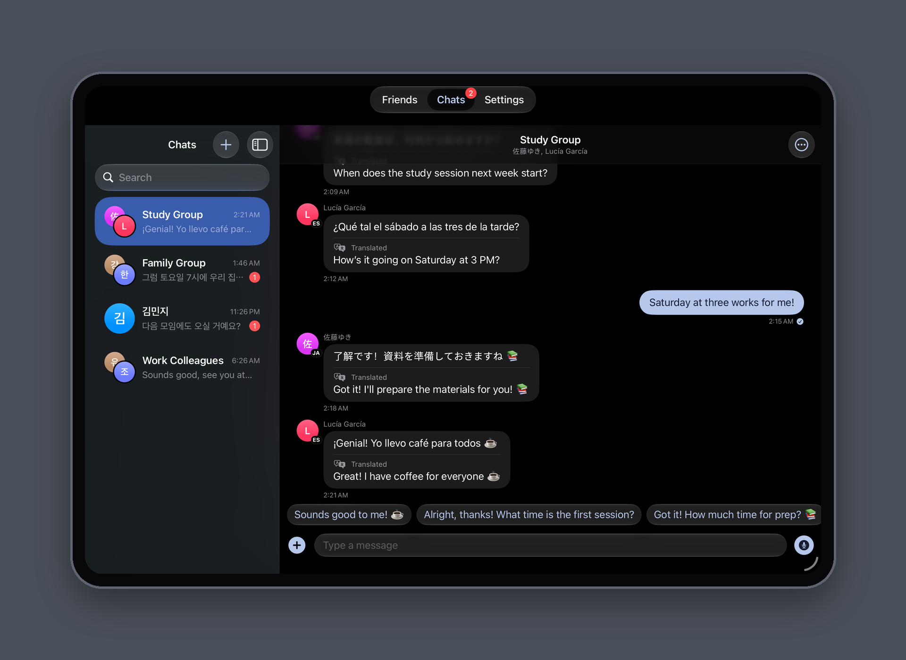

# L!NK

**Messaging without borders.**

You write in Korean, they answer in Japanese, and you both read your own language. L!NK is a messenger anyone can pick up, older people included: one obvious place for each action, text that grows as large as iOS allows, and the translation inside every message, not under it.

Every AI feature runs on the device with Apple Intelligence, and there is no server: the people in the sample chats are simulated, so anyone can try the app in Test Mode without an account.

## Beyond translation

iOS 26 already translates Messages as you read them. L!NK works on what comes after the translation, and on making the AI's part easy to check:

- **Search by meaning, across languages.** "dinner plans" finds "이번 주말에 다 같이 저녁 먹을까요?", and the chat shows which words it added to the search.
- **Summaries in your language, and meeting notes**, from a chat that mixes languages. Every task quotes the message it came from, and dates are read by a date detector, not the model.
- **AI that says it's AI.** Translations are labeled inside the bubble, the summary carries the Apple Intelligence mark, and a suggested reply goes into the message field for you to change or send: nothing is sent for you.
- **Nothing made up.** No fake "online" status or connection banner: under a chat's name is what the app knows, a group's members or the language the other person writes in.

## Features

- **Inline translation**: every message, translated on device, across seven languages.
- **On-device AI**: chat summaries, meeting notes with owners and dates, reply suggestions, search by meaning across languages, and photo descriptions on iOS 27.
- **Messaging**: voice messages with transcripts, photos, files, locations, reactions, and disappearing and scheduled messages.
- **Easy for everyone**: Dynamic Type up to the largest sizes, VoiceOver that reads each translation with its message, high-contrast bubbles, the same face for each person everywhere, five app languages, Siri and Shortcuts, and App Lock.
- **Any screen**: iPhone, iPad, and iPhone Duo folded or open.

## Screenshots

Sample chats on the iOS 27 simulator. The translations, replies, summaries and notes in them are real output of the on-device models.

**Reply suggestions and search by meaning.** Three short replies appear when someone writes. Searching "dinner plans" in English finds the Korean message about dinner.

**Summary and meeting notes.** Every task quotes the message it came from, and dates come from a date detector, not the model.

**iPad.** In a wide window the chat list stays beside the conversation.

## How it's built

SwiftUI and SwiftData, MVVM with protocol-backed repositories, Foundation Models, the Translation and Speech frameworks, and App Intents. It runs on iOS 26 and later and turns on iOS 27 features where they exist. Swift Testing covers the logic, and XCTest UI tests run on iPhone and iPad.

[docs/ENGINEERING.md](docs/ENGINEERING.md) covers what took the most work, such as keeping a small on-device model from inventing tasks, plus the project structure, running on an iPhone, and the test commands.

## Try it

1. Open `TalkMVP.xcodeproj` in Xcode 27 or later.
2. Run it on an iOS 26 or later simulator.
3. Tap **Try Test Mode** to start with sample friends and chats.

## License

Copyright © 2025–2026 David Song. All rights reserved.

This repository is published on GitHub for portfolio purposes. Being able to view the source does not grant any license to use it — no permission is given to copy, modify, distribute, or reuse this code, in whole or in part, including as training data for AI models, without prior written permission. Viewing and forking on GitHub are allowed only as GitHub's Terms of Service provide, and a fork grants no further rights. To ask for permission, contact [@mobssy](https://github.com/mobssy). See [LICENSE](LICENSE).
